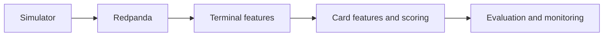

# Streaming fraud detection

A simulated event-time fraud pipeline and cost-sensitive evaluation study.

## Offline smoke experiment

`uv sync --frozen`, then run `make data-tiny`, `make backfill-tiny`, and
`make e1-tiny`. This is an initial synthetic-data smoke run, not the full E1
study. It uses one simulator seed; confidence intervals and streaming
measurements are not yet implemented.
<!-- results:start -->
Not yet measured.
<!-- results:end -->
