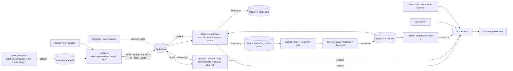

# Project plan: streaming fraud detection (P3)

> Appendix A of the approved implementation plan, verbatim, followed by the Step 3 amendments that apply to this project.

### Step 3 — Project 3: streaming fraud detection (Appendix A, phases P0–P9)

Implement Appendix A with these amendments:
- E7 arms are A (inline), B (Redis/Feast lookup), C (B + FastAPI HTTP model server), all with native LightGBM. `OnnxScorer`, `onnxruntime`, `skl2onnx`/`onnxmltools` move to stretch; delete them from the `ml` group and from `Scorer` implementations in MVP.
- Remove `evidently` from the `eval` group (stretch only). Keep `river` (ADWIN for E6).
- Dependency groups: `feast` group holds `feast==0.68.0`; the worker Docker image installs groups `stream` + `ml` only. All groups still resolve in one `uv.lock` (pandas `<3`, numpy `<3` apply project-wide).
- Redpanda service image: `redpandadata/redpanda:v26.3.1`, started with `--smp 1 --memory 1G --overprovisioned`, admin/metrics port 9644.
- Sparkov (`make data-sparkov`) runs only when `~/.kaggle/kaggle.json` exists; otherwise the target prints `skipped: no Kaggle token` and exits 0, and E1 omits the Sparkov column.
- Disk cap 15 GB (Redpanda `retention.bytes` sized accordingly).
- `make bench-*`, E7, E8, E9, E10 load runs use the exclusive machine lock; E5 uses the shared lock.

## Appendix A — Project 3 spec (FraudStreamPlanner)

### Project 3: Real-Time Streaming Fraud Detection (`aryanbarik/streaming-fraud-detection`, package `fraudstream`)

#### 1. Scope & architecture

**One-line thesis.** I build a CPU-only, Docker-local streaming fraud system and measure one joint surface: **net financial savings ↔ operational cost (CPU-seconds per 1k transactions) ↔ real-time performance (p99 latency, fail-open rate under load)**.

##### Decisions that challenge the brief (one paragraph each)

**Data: simulator primary, Sparkov secondary, no ULB or IEEE-CIS.** No public dataset has controllable drift, label delay and a feedback loop together. I write my own event-time simulator (`fraudstream.sim`), inspired by the Le Borgne et al. handbook design (customer/terminal profiles, fraud scenarios). It adds delayed label events, card-testing and impossible-travel scenarios, and scheduled drift. The handbook's code is GPL-3.0 and its prose is CC BY-SA 4.0 (read: https://github.com/Fraud-Detection-Handbook/fraud-detection-handbook). I therefore reimplement from the described design and copy no code, which keeps my repo MIT. Sparkov (`kartik2112/fraud-detection`) is the secondary "real-ish" replay. It has card, merchant and timestamp fields, so the same feature code applies. Reported only as a pipeline-validation column, not a headline. ULB creditcard is rejected: PCA features with no card or terminal id, so the behavioral features cannot be computed. IEEE-CIS is rejected as primary: it needs a Kaggle account and competition-rules acceptance, redistribution is likely prohibited, and the entity id has to be reconstructed. All three of those claims are `unverified — confirm first`. PaySim is rejected: no card-level behavioral history. Also `unverified`. Kaggle downloads (Sparkov only) need a Kaggle account and API token at `~/.kaggle/kaggle.json`. CI and `make reproduce-small` never need one.

**Stream processor: Quix Streams (pure Python), not Flink.** It is Apache-2.0, pure Python, with a Streaming DataFrame API, RocksDB-backed fault-tolerant state, windowing, group-by, and exactly-once via Kafka transactions (read: https://github.com/quixio/quix-streams; PyPI quixstreams 3.28.1, requires Python ≥3.11). Flink/PyFlink would add JVM containers costing several GB, and the ML code would have to cross a language boundary. The honest cost is that per-event Python throughput is limited. I measure that ceiling and scale it with partitions, and the saturation curve is itself a deliverable. Bytewax and faust-streaming were rejected, with less ecosystem and a weaker exactly-once story (unverified).

**Broker: Redpanda single node, not Kafka KRaft.** One binary with no JVM. Flags `--smp 1 --memory 1G --overprovisioned` and the Prometheus/admin port 9644 are verified from https://github.com/redpanda-data/redpanda-examples/blob/main/docker-compose/redpanda-one-node.yml. That example pins an old image (v21.11.11), so pin a current tag after checking it exists (`unverified — confirm first`). Kafka-API compatibility means Quix and confluent-kafka work unchanged, and an ADR records "Kafka KRaft would be a drop-in swap".

**Feature store: Feast for registry, offline point-in-time (PIT) join and Redis online push; the streaming aggregates are computed by my own code.** Feast 0.68.0 (Apache-2.0, Python ≥3.11) offers `get_historical_features` PIT joins, Redis online store and push ingestion (read: PyPI feast JSON). Its streaming transformations are alpha. So one pure-Python `FeatureState` is the single feature definition. Online it runs incrementally in Quix. Offline it is replayed over history to produce the backfill. Feast ties the two together and serves PIT retrieval. The Phase-5 spike has a go/no-go gate. If Feast fails, fall back to a hand-rolled DuckDB `ASOF JOIN` PIT joiner (`unverified — confirm first`), and the skew test is unchanged.

**Scoring path: inline by default, with a 3-way serving comparison as an experiment.** Production-grade fraud systems score in the stream processor. Putting FastAPI in the hot path by default would invent latency. But the comparison is a better portfolio artifact than either choice alone. Arms: **A** inline local-state features plus in-process LightGBM; **B** Redis (Feast) feature lookup plus in-process model; **C** B plus HTTP FastAPI model server. This quantifies the cost of each service boundary.

**Models: rules, LR, LightGBM (main), Isolation Forest; no GNN in MVP.** There is no graph signal beyond the terminal/card features that I already engineer, so a GNN is unjustified and goes to stretch. Autoencoder is stretch.

**Label feedback.** In the offline harness, labels follow a closed loop. Alerts within investigator capacity get labelled fast, and un-alerted fraud is only revealed by customer chargeback after a long delay. The streaming benchmark replays a fixed open-loop label timeline. Both are documented. See §6.

##### Architecture (mermaid, for README)



##### Components

`sim`, `features` (spec/state/derive/backfill/feast_repo), `stream` (loadgen, terminal stage, card stage, sinks, metrics, lag exporter), `models`, `serving`, `evaluation` (LabelView, splits, cost, prequential), `drift`, `bench` (load, failure, resources), `reporting`.

Event-time rule: **every feature uses `event_ts` from the message, never wall clock.** This makes offline replay and online serving comparable at any TPS.

Topology rule: tx and label events share one topic, `events.raw`, ordered by availability time and keyed by `terminal_id`. Terminal state is the only label-dependent state, so label ordering is deterministic per key. Card state depends only on tx events.

#### 2. Literature & existing implementations

| Source | URL | Take / avoid |
|---|---|---|
| Le Borgne et al., *Reproducible ML for Credit Card Fraud Detection – Practical Handbook* (read: simulator chapter, repo README) | https://fraud-detection-handbook.github.io/ | Take: profile-based design (customers with mean amount, tx/day, location; terminals within radius), scenarios (S2 compromised terminals for 28 days; S3 stolen credentials, 14 days, 1/3 of tx ×5), prequential/top-k/cost-sensitive evaluation chapters. Avoid: copying code (GPL-3.0); handbook S1 (amount>220) is a trivial sanity case only. |
| Dal Pozzolo et al., *Credit Card Fraud Detection: a Realistic Modeling and a Novel Learning Strategy*, IEEE TNNLS 2017 (title/search listing only; abstract not read) | https://dalpozz.github.io/static/pdf/TNNLS_2017.pdf | Take (from my prior knowledge, `unverified — confirm first`): the distinction between investigator feedback and delayed supervised samples, and the alert-precision metric framing. |
| Quix Streams | https://github.com/quixio/quix-streams | Stateful processing, group-by, exactly-once. Avoid relying on cross-topic ordering. |
| Feast | https://pypi.org/project/feast/ (docs https://docs.feast.dev/) | PIT-correct `get_historical_features`, push to online store. Avoid Feast alpha streaming transforms. |
| River (BSD-3, 0.27.0) | https://pypi.org/project/river/ | `ADWIN` drift detector, online learners (stretch arm). |
| Evidently 0.7.23 | https://docs.evidentlyai.com/metrics/preset_data_drift | Offline drift HTML report. Not in the hot path. |
| Amazon Fraud Dataset Benchmark (lists ieeecis and sparknov) | https://github.com/amazon-science/fraud-dataset-benchmark | Reference for dataset choices and baseline AUC context. |
| Sparkov dataset on Kaggle | https://www.kaggle.com/datasets/kartik2112/fraud-detection | Secondary dataset. The page did not render in my fetch, so license and size are `unverified — confirm first`. |
| Dal Pozzolo et al. 2015, undersampling probability correction (not read this session) | cite from memory | Prior-correction formula for undersampled training. Confirm the formula in the paper before coding. |

#### 3. Differentiation

This is not a tutorial because it (a) measures instead of asserting, (b) treats label delay as a first-class protocol, and (c) puts ML metrics and systems metrics on the same dollar axis.

Headline questions (not answers):
1. **How much does naive validation overstate performance?** PR-AUC and savings under random K-fold, immediate-label features, and a non-PIT join, versus the leak-free protocol.
2. **For a given label delay and drift type, what retraining cadence maximises net savings per CPU-hour, and does label-free drift detection trigger a retrain earlier than delayed-label monitoring?** Benign covariate drift (a holiday) is included so the false-alarm cost is measured.
3. **Where does the latency budget break, and what does it cost in fraud losses?** Beyond the saturation TPS, p99 exceeds the authorization deadline and the system fails open. Does a rules-only degradation mode recover savings?

#### 4. Technology selection

| Concern | Choice (verified version) | Rejected |
|---|---|---|
| Language/tooling | Python 3.12, uv, ruff, pytest (repo convention) | – |
| Broker | Redpanda single node, pin tag after check | Kafka KRaft (JVM, heavier), RabbitMQ (no log replay) |
| Stream processor | quixstreams 3.28.1 | Flink/PyFlink (JVM weight), Bytewax, faust-streaming (unverified maintenance) |
| Kafka client | confluent-kafka (pinned by quixstreams: `>=2.8.2,<2.13`) | kafka-python (slow) |
| Feature store | feast 0.68.0 + Redis online | Hand-rolled (kept as pre-decided fallback with DuckDB ASOF) |
| Online store | Redis (tag pinned at impl.) | Postgres (higher latency) |
| Models | lightgbm 4.7.0, scikit-learn (LR, IsolationForest) | XGBoost (redundant), deep nets (no CPU-budget justification) |
| Online learning arm (stretch) | river 0.27.0 | – |
| Model-server arm | FastAPI + uvicorn (also a Feast dependency) | gRPC/BentoML (extra surface) |
| Alt runtime microbench | onnxruntime 1.32.0 (MIT) via skl2onnx/onnxmltools (versions resolved at lock) | treelite (compat unverified) |
| Drift | custom PSI + river ADWIN online; evidently 0.7.23 offline report | alibi-detect (maintenance unverified) |
| Observability | prometheus_client, Prometheus, Grafana provisioned, cAdvisor (or `docker stats` exporter fallback). Image versions `unverified — confirm first` | OpenTelemetry tracing (stretch; stage timestamps in messages give the same breakdown) |
| Failure injection | `docker pause/kill/stop`, Toxiproxy (image `unverified — confirm first`) | chaos-mesh (k8s only) |
| Serialization | JSON via orjson (quixstreams dep) | Avro/schema-registry (stretch) |
| Reporting | matplotlib → PDF+PNG, DuckDB/pandas | notebooks |

Constraint: Feast requires `pandas<3`, `numpy<3` (PyPI metadata). `uv lock` must resolve all groups. Put Feast in a `[dependency-groups] feast` group and keep it out of the scorer image if it conflicts.

#### 5. Data & compute

- **Simulator defaults** (`configs/sim_default.yaml`): 10,000 customers, 3,000 terminals, 180 days, about 3.6M tx (about 2 tx/day/customer, by analogy with the handbook's U(0,4) rate), start `2025-01-01`. Expected fraud rate 0.3–1% (to be measured). Parquet is about 0.3 GB.
- **Sparkov** (secondary): Kaggle API download, `make data-sparkov`. Size and license `unverified — confirm first`. Budget 1 GB. Not redistributed. The repo ships only the adapter.
- **Disk budget (cap 20 GB, target ≈12 GB):**

| Item | GB |
|---|---|
| uv venv (lightgbm, sklearn, pandas, pyarrow, feast+dask) | 3 |
| Docker images (redpanda, redis, prom, grafana, cadvisor, python base) | 3 |
| Redpanda volume (capped via `retention.bytes`) | 2 |
| Sim parquet, 5 seeds × 0.3 | 1.5 |
| Feature logs / backfills | 2 |
| Sparkov raw + parquet | 1 |
| Models, results, charts | 0.5 |

- **RAM estimate (to be measured and reported in `results/footprint`):** Redpanda ≈1.5 GB (1G flag plus overhead), Redis 0.1, 2× terminal workers 0.6, 2–4× card workers 1.2, model server 0.3, Prometheus 0.3, Grafana 0.2, cAdvisor 0.1, lag exporter 0.05, loadgen 0.3. About 4.5–5 GB total, far below 31 GiB.
- **CPU:** all local, no GPU needed. LightGBM on 3.6M rows with a 1:10 undersample trains in seconds to a minute.
- **CPU pinning:** use compose `cpuset` for broker, workers and loadgen so loadgen does not steal worker cores. First run `lscpu -e` to confirm sibling numbering (`unverified — confirm first`). Fallback is no pinning, documented in results as a caveat.
- **Wall-clock estimates (assumptions, replace with measurements):**

| Step | Estimate |
|---|---|
| Sim generation | ~5–10 min/seed |
| Offline backfill replay of 3.6M events | ~10–30 min |
| E1/E4 | <1 h |
| E5 grid | ≈3,400 trainings × ~8 s ≈ 8 h overnight |
| E8/E9 benchmarks | ~3 h total |

  Pre-decided: if E5 estimates exceed 8 h, reduce delays to {1,7,30} and seeds to 3. Kaggle/Colab is only needed as an optional offload for E5, since it does not need Docker.
- **Cost: $0.** The price assumption used for the "$ per 1M transactions" axis is a labelled parameter (`ops.vcpu_hour_usd: 0.04`, an assumption, not a quote).

#### 6. Experimental design

**Cost model** (`configs/cost.yaml`; assumptions with a sensitivity sweep): missed fraud costs `amount` (`fraud_fixed_fee_usd: 0`). Each alert costs `review_usd: 5`. Each false-positive alert additionally costs `fp_friction_usd: 3`. Baseline loss = Σ fraud amount (no model). **Net savings = baseline loss − (Σ FN amount + Σ alerts × review + Σ FP × friction)**.

**Delayed labels:** each fraud tx has `p_report=0.85`, with delay ~ lognormal (median 7 days, σ=0.8). The other 15% stay hidden and appear as legit. `LabelView(as_of=T)` returns label=1 only if `available_ts ≤ T`, and a tx is "mature" if `ts ≤ T − 14d`.

**Static protocol (E1 etc.):** `T=90`. Train rows `ts ∈ [0, T−G−V)`. Validation `ts ∈ [T−G−V, T−G)` with `G=14`, `V=14`, labels as of T, used for early stopping, calibration and thresholds. Test `ts ∈ [T, T+30)` with fully matured ground-truth labels. No overlap in time, and features are only PIT-correct values.

**Closed-loop harness (E5/E6):** each simulated day the model scores, the top-K alerts (`K = 0.1% of daily volume`, config `investigators.capacity_per_day`) are investigated and labelled after 1 day, and un-alerted fraud is labelled via the lognormal customer-report path. The model is retrained per cadence on a sliding or expanding window of labels visible as-of that day.

**Seeds and statistics:** 5 simulator seeds (E1, E3, E4, E7), 3 training seeds each. E5 uses 3 seeds. Report mean ± 95% CI (t-interval over seeds). Within-seed daily metrics use a day-block bootstrap (1,000 resamples). Compare methods with paired differences and bootstrap CI. Do not claim an effect whose CI spans 0.

**Metrics (exact):**
- PR-AUC = `average_precision_score`, over test rows.
- Recall@FPR1% = recall at the threshold giving FPR=1%.
- FPR at operating threshold = FP/(FP+TN).
- Daily top-K precision = mean over days of (fraud in top-K scored tx)/K.
- Net savings ($), per the cost model.
- Calibration: Brier score and ECE (10 bins).
- Operational: e2e latency = `t_scored_emit − t_produced` (wall ns, raw samples stored to parquet, percentiles from raw). CPU-s/1k tx = Σ container CPU seconds / (tx/1000). Fail-open fraction = fraction scored after deadline `D=100 ms` (config `slo.deadline_ms`) treated as approved. **Effective savings = savings of the scored subset** (late-scored tx count as unscreened).
- Recovery time = days after drift onset until rolling-7d PR-AUC ≥ 90% of the pre-drift level.
- Detection delay = day alarm − day drift onset; false alarm count on drift-free control seeds.

**Drift scenarios** (`drift:` config): `abrupt_concept` (day 100: terminal-compromise rate ÷2, impossible-travel ATO ×3, amount shift); `gradual_prior` (fraud rate ×1→×3 over days 90–130); `benign_covariate` (days 120–135: amount ×1.5, volume ×1.4, P(fraud|x) unchanged).

| id | Question | Independent variable | Fixed | Metric | Artifact |
|---|---|---|---|---|---|
| E1 | Do ML models beat rules and are gains meaningful? | model ∈ {rules, LR, IForest, LGBM} | features, split, imbalance=best-of-E4 | PR-AUC, Recall@FPR1%, top-K precision, savings | `charts/e1_models.{pdf,png}`, `tables/e1.md` |
| E2 | Does online equal offline? | injected bug ∈ {none, tz-shift, window off-by-one, label-order swap} | 100k events | max abs feature diff, mismatch rate | `tables/e2_skew.md` |
| E3 | How much does leakage inflate results? | protocol ∈ {correct, random-KFold, immediate-label feats, non-PIT join} | LGBM | PR-AUC, savings, inflation Δ | `charts/e3_leakage.*` |
| E4 | Which imbalance handling? | {none, class_weight, scale_pos_weight, undersample 1:10 + prior correction, focal} | LGBM | PR-AUC, Brier/ECE, savings | `charts/e4_imbalance.*` |
| E4b | Cost-asymmetric threshold | threshold rule ∈ {0.5, F1-opt, min-loss on val, capacity-top-K} × cost ratio sweep | best model | savings vs cost ratio | `charts/e4b_threshold.*` |
| E5 | Retrain cadence vs label delay vs drift | cadence ∈ {never,30,14,7,3,1 d} × delay ∈ {1,7,14,30 d} × drift ∈ {abrupt, gradual} × window ∈ {sliding,expanding} | model, cost | cumulative savings, recovery time, retrains/CPU-s | `charts/e5_cadence_heatmap.*`, `charts/e5_recovery.*` |
| E6 | Detection: label-free vs label-based | detector ∈ {PSI features, PSI score, ADWIN score, rolling PR-AUC (delayed)} × drift ∈ {3 scenarios + control} | thresholds fixed a priori | detection delay, false alarms; savings of detector-triggered retrain vs fixed cadence | `charts/e6_detection.*` |
| E7 | Cost of serving boundaries | arm ∈ {A inline, B Redis lookup, C Redis + HTTP}; runtime ∈ {LGBM native, ONNX RT} | 500 TPS, 1 worker | p50/p99 latency, stage breakdown, CPU-s/1k | `charts/e7_latency_breakdown.*` |
| E8 | Throughput/volume scaling | offered TPS ∈ {100,250,500,1k,2k,4k,8k} × workers ∈ {1,2,4} | arm A | p99, achieved TPS, lag, fail-open %, effective savings | `charts/e8_load_curve.*` |
| E9 | Failure behavior | fault ∈ {processor kill, broker pause 30 s, Redis stop, model-server slowdown via Toxiproxy} × semantics ∈ {at-least-once+dedupe, exactly-once} | 1k TPS | lag peak, recovery s, lost, duplicate count | `tables/e9_failures.md`, `charts/e9_lag_recovery.*` |
| E10 | **Primary deliverable** | config grid: features {cheap, medium, rich} × model {LR, LGBM-100, LGBM-500} × arm {A,C} × load | – | effective net savings vs CPU-$/1M tx vs p99; Pareto frontier | `charts/e10_pareto.*` |
| E11 | Degradation policy (stretch if time) | shed policy {off, rules-only fallback when lag age > L} at overload | arm A, 2× saturation | effective savings | `charts/e11_shedding.*` |

E1/E3/E4: protocol above. E2 compares the serve-time logged vector (in `tx.scored`) to the offline reconstruction through Feast PIT + `derive`. Float tolerance is 1e-9 absolute (decided), ints exact.

**Load testing:** open-loop (schedule by target timestamp via `perf_counter_ns`, never wait for responses), to avoid coordinated omission. One loadgen process emits ≈5–20k msg/s (`unverified` — measure first). If it falls short, run N processes. Warm-up 30 s discarded. Each point runs 120 s at steady state, 3 repetitions.

**Semantics:** exactly-once relies on Quix `processing_guarantee="exactly-once"` (documented via the README link; exact kwarg `unverified — confirm first`) over Redpanda transactions (`unverified — confirm first`). The at-least-once arm dedupes in the sink on `tx_id` (idempotent upsert).

#### 7. Success criteria

1. `git clone … && make reproduce-small` runs end to end with no network, no Kaggle token, in ≤25 min on the reference machine: tiny sim (1k customers × 30 days), backfill, train, stream through compose, skew test passes, README results block regenerated.
2. Skew test: ≥100k events, max abs diff ≤1e-9 on floats, 0 mismatches on ints. Each of the 3 injected bugs makes the test fail.
3. Leakage: E3 reports the measured inflation for each leaky protocol, whatever the sign or size.
4. Latency and throughput: p50/p99 per stage and e2e at ≥5 load levels, with CIs over 3 reps and raw samples checked into results. The p99 under 1k TPS is reported honestly, with 100 ms as the design deadline and not a promise.
5. Failure experiments: ≥4 faults, each with measured recovery time and zero lost events in exactly-once mode (or a documented violation).
6. E10 Pareto chart generated by script from `metrics.json` files only, with git SHA and config snapshot in each run directory.
7. CI (lint plus unit tests, no Docker) green. Every README number is inside `<!-- results:start -->…<!-- results:end -->`, written by `make results`.

#### 8. MVP vs stretch

**MVP:** simulator with 3 fraud scenarios and 3 drift types; shared `FeatureState`; offline backfill; Feast online/offline integration (or the DuckDB fallback); models rules/LR/LGBM/IForest; E1–E5, E7–E10; Quix 2-stage pipeline; Prometheus + Grafana; Sparkov adapter feeding E1 (one extra column); results-driven README.

**Stretch:** E11 shedding; river online-learner arm; Evidently HTML report; ONNX in the full pipeline; micro-batch scoring; Avro schema registry; autoencoder baseline; GNN on the card–terminal graph; OpenTelemetry tracing; Kaggle offload script for E5.

#### 9. Phased milestones

Conventions: `src/fraudstream/`, `tests/`, `configs/`, `deploy/`, `docs/decisions/`, `results/`, Makefile targets named per phase. pytest markers: `network`, `slow`, `gpu`, plus new `docker` (Docker-based tests). CI runs `-m "not network and not slow and not gpu and not docker"`.

##### P0. Scaffold (1 d)
```
pyproject.toml  .python-version  Makefile  .github/workflows/ci.yml  README.md
docs/project-plan.md  docs/decisions/0001-sim-primary.md  …0002-quix-redpanda.md  …0003-feast-skew.md
src/fraudstream/{__init__,config}.py  tests/test_smoke.py
```
`pyproject.toml`: `requires-python=">=3.12,<3.13"`; dependency-groups `dev` (pytest, ruff), `feast` (feast==0.68.0), `ml` (lightgbm==4.7.0, scikit-learn, onnxruntime==1.32.0, river==0.27.0), `stream` (quixstreams==3.28.1, redis, prometheus-client, orjson), `eval` (matplotlib, duckdb, evidently==0.7.23). `config.py`: pydantic-settings models `SimConfig`, `CostConfig`, `StreamConfig`, loaded from `configs/*.yaml`.
**Done:** `uv sync --frozen && uv run ruff check && uv run pytest -m "not network and not slow and not gpu and not docker"`.

##### P1. Simulator (4 d)
```
src/fraudstream/sim/{schema,profiles,generator,scenarios,drift,labels,cli}.py
configs/sim_default.yaml  configs/sim_tiny.yaml
tests/sim/{test_determinism,test_scenarios,test_labels,test_drift}.py
```
Interfaces:
- `generate(cfg: SimConfig, seed: int) -> pa.Table` (tx columns: `tx_id:int64, event_ts:timestamp[us], card_id:int32, terminal_id:int32, amount:float32, mcc:int8, channel:int8, x:float32, y:float32, is_fraud:int8, scenario:int8`).
- `make_label_events(tx: pa.Table, cfg: LabelConfig, seed) -> pa.Table` (cols `tx_id, terminal_id, available_ts, kind`).
- `apply_drift(cfg: DriftConfig)` is applied inside the generator.
- CLI: `python -m fraudstream.sim.cli --config configs/sim_default.yaml --seed 0 --out data/sim/seed0`.

Config keys: `n_customers`, `n_terminals`, `days`, `radius`, `scenarios.{compromised_terminal,stolen_card,card_testing,impossible_travel}.{rate_per_day,…}`, `labels.{p_report,median_delay_days,sigma}`, `drift.{kind,start_day,end_day,magnitude}`. Generator is vectorised per day with numpy `Generator(PCG64(seed))`.
Tests: same seed gives byte-identical parquet; fraud rate within [0.2%,2%]; label `available_ts ≥ event_ts`; each scenario produces its signature; drift changes the marginals only inside the window.
**Done:** `uv run pytest tests/sim && make data-tiny`.

##### P2. Features & offline backfill (3 d)
```
src/fraudstream/features/{spec,state,derive,backfill}.py
tests/features/{test_state,test_derive,test_backfill_equiv,test_no_future}.py
```
Interfaces:
- `FEATURES: list[FeatureSpec]` is the one definition (name, dtype, entity ∈ {card, terminal}, window).
- `class CardState: def read(self) -> dict; def update(self, tx: Tx) -> None` (bucketed rings: 1 h as 60 minute-buckets, 24 h and 7 d as hourly buckets; Welford mean/std; last_ts, last_xy; small distinct-terminals set).
- `class TerminalState: def read(); def update_tx(tx); def apply_label(label)` (counts 1 h/24 h; delayed fraud-confirm count and rate over 7 d, using only labels with `available_ts ≤ t`).
- `derive(tx, card_feats, term_feats) -> dict[str, float]` is a pure function: amount/mean ratio, z-score, hour/weekday, impossible-travel speed, etc.
- `backfill(events: pa.Table, out: Path) -> None` replays events in availability order through the same classes and writes `(event_ts, entity_id, features…)` parquet.
- Pre-update rule: the feature vector for tx j is read before `update(tx_j)`.

Tests: property test "prefix invariance" (adding future events never changes earlier vectors); replay vs incremental equality; label with `available_ts > t` never visible.
**Done:** `uv run pytest tests/features`.

##### P3. Offline evaluation & models (4 d)
```
src/fraudstream/evaluation/{labelview,splits,metrics,cost}.py
src/fraudstream/models/{rules,train,imbalance,calibrate,registry}.py
src/fraudstream/experiments/{e1_models,e3_leakage,e4_imbalance,e4b_threshold}.py
src/fraudstream/datasets/sparkov.py
configs/models/*.yaml
tests/evaluation/…  tests/models/…
```
Interfaces:
- `LabelView(table, as_of: Timestamp).labels() -> np.ndarray`.
- `temporal_split(T: int, G: int, V: int) -> SplitIdx`.
- `net_savings(y, score, amount, thr, cost: CostConfig) -> float`.
- `pick_threshold(rule: Literal["min_loss","f1","capacity"], …) -> float`.
- `train(model: str, X, y, cfg) -> ModelBundle`.
- `ModelBundle.save(dir)` writes `model.txt` + `manifest.json` {git_sha, feature_list, calibration, threshold, train_window}.
- Imbalance variants as in E4, with the 1:10 undersample plus prior-correction formula (confirm against the paper).

Tests: metric values on hand-checked tiny arrays; LabelView hides future labels; split has no time overlap; savings for a perfect oracle equals baseline loss minus review cost.
**Done:** `uv run pytest tests/evaluation tests/models && make e1-tiny`.

##### P4. Streaming pipeline (5 d)
```
deploy/docker-compose.yml  deploy/Dockerfile
src/fraudstream/stream/{topics,schemas,loadgen,terminal_stage,card_stage,sinks,metrics,lag_exporter}.py
src/fraudstream/serving/scorer.py
tests/stream/{test_schemas,test_stage_unit,test_pipeline_docker}.py (docker marker)
```
Topics: `events.raw` (key terminal_id, partitions 6), `tx.term` (key card_id, 6), `tx.scored` (key tx_id), `tx.dlq`.
Interfaces:
- `loadgen.run(parquet: Path, tps: int, duration_s: int, ramp: list[tuple[int,int]]) -> None` (open-loop; stamps `t_produce_ns`).
- Each stage appends stage timestamps `t_stageA_in/out`, `t_stageB_in`, `t_feat`, `t_score`, and `t_emit`.
- `class Scorer(Protocol): def score(self, x: np.ndarray) -> float` with `LGBMScorer`, `OnnxScorer`, `RulesScorer`.
- Quix `Application(broker_address=…, consumer_group=…, processing_guarantee=…)`.
- Env keys: `BROKER`, `SCORER_KIND`, `MODEL_DIR`, `GUARANTEE`.

Tests: unit tests for stage functions with fake state; Docker test sends 10k tiny events and asserts 10k scored with latency fields populated.
**Done:** `make up && make smoke` (loads tiny data, asserts counts on `tx.scored`).

##### P5. Feast integration & skew test (3 d, time-boxed spike first)
```
src/fraudstream/features/feast_repo/{feature_store.yaml,definitions.py}
src/fraudstream/features/{online_push,pit}.py
tests/features/test_skew.py  (docker marker)
```
Definitions: `Entity(card_id)`, `Entity(terminal_id)`, `FileSource`/parquet feature log, `FeatureView`s mirroring `FEATURES`, `PushSource` for the online path. Spike gate (day 1): confirm that (i) a PIT join with strict `<` works (tie handling via 1 µs epsilon), (ii) a parquet directory source or rolling files work, (iii) a Redis push is fast enough off the hot path. All three `unverified — confirm first`. If any fails, implement `pit.py` as a DuckDB `ASOF JOIN` and drop `feast_repo`; interfaces unchanged: `pit_join(entity_df, feature_log) -> pd.DataFrame`.
Test: run 100k events live, join serve-time vectors against `pit_join`+`derive`, assert tolerance; the three injected bugs (E2) must fail.
**Done:** `make skew-test`.

##### P6. Observability (2 d)
```
deploy/prometheus/prometheus.yml  deploy/grafana/provisioning/{datasources,dashboards}/*.yml
deploy/grafana/dashboards/{pipeline,model,system}.json
```
Metrics (names are fixed): `fs_stage_latency_seconds{stage}`, `fs_e2e_latency_seconds`, `fs_events_total{stage,status}`, `fs_consumer_lag_seconds{group}`, `fs_score_distribution`, `fs_alert_rate`, `fs_feature_psi{feature}`, `fs_state_size_bytes`, container CPU/mem via cAdvisor. Lag exporter uses confluent-kafka watermarks minus committed offsets (no dependence on Redpanda metric names).
**Done:** `make up && make smoke && curl -s localhost:9090/api/v1/targets` shows all targets UP; dashboards render with data (screenshot in `docs/img/`).

##### P7. Drift & retraining study (4 d)
```
src/fraudstream/drift/{psi,adwin_monitor,report}.py
src/fraudstream/evaluation/prequential.py
src/fraudstream/experiments/{e5_retrain,e6_detection}.py
```
Interfaces: `psi(ref: np.ndarray, cur: np.ndarray, bins=10) -> float`; `class DriftMonitor: def update(x) -> bool`; `simulate(cfg: LoopConfig) -> DailyMetrics` (closed loop with `capacity_per_day`, `retrain_every`, `window`, `label_delay`).
Tests: PSI = 0 for identical samples; ADWIN fires on a synthetic mean shift and not on stationary noise (fixed seed); closed-loop never reads a label beyond `as_of`.
**Done:** `make e5-tiny e6-tiny`.

##### P8. Benchmarks & failure injection (4 d)
```
src/fraudstream/bench/{loadsweep,failures,resources,summarize}.py
deploy/toxiproxy/…
```
Interfaces: `loadsweep.run(arm, tps_list, workers, reps) -> results dir`; `failures.run(fault, guarantee) -> results dir`; faults: `docker kill`, `docker pause` (broker, 30 s), `docker stop redis`, Toxiproxy latency toxic on the model server. `summarize` computes percentiles from raw latency parquet.
Tests: unit tests for percentile math and open-loop schedule drift; Docker test that a killed worker resumes and the event count matches.
**Done:** `make bench-smoke` (1 load point, 1 fault).

##### P9. Reporting & docs (3 d)
```
src/fraudstream/reporting/{charts,fill_readme}.py
docs/{architecture.md,reproduction.md,results.md}
```
Charts are generated only from `results/**/metrics.json` (matplotlib, vector PDF + PNG). `fill_readme` rewrites the `results:start/end` block. Each run directory contains `metrics.json`, `config.yaml`, `git_sha.txt`.
**Done:** `make results && git diff --stat README.md`.

#### 10. Effort & cost

| Phase | Engineer-days | Compute |
|---|---|---|
| P0 | 1 | – |
| P1 | 4 | ~1 h |
| P2 | 3 | ~1 h |
| P3 | 4 | ~3 h |
| P4 | 5 | ~1 h |
| P5 | 3 | ~1 h |
| P6 | 2 | – |
| P7 | 4 | ~8 h (E5 overnight) |
| P8 | 4 | ~3–4 h |
| P9 | 3 | – |
| **Total** | **33** | **≈ 18–20 h, local CPU** |

Cost: **$0.** Optional: Kaggle/Colab free tiers for offloading E5.

#### 11. Risks & fallbacks

- If Feast's PIT join, parquet source or push behavior fails the P5 spike, then use the DuckDB ASOF PIT joiner and keep Redis writes in my own code. The skew test is unchanged.
- If Quix throughput is too low to show a saturation knee below 8k TPS, then add workers (up to 6 partitions) and report the scaling curve. If it still cannot sustain 1k TPS, switch the card stage to a plain confluent-kafka consumer with the same `FeatureState` and record an ADR.
- If cross-topic ordering produces label-order skew, keep the single `events.raw` topic, which is already the design. The injected "label-order swap" bug in E2 demonstrates the risk.
- If the loadgen cannot reach target TPS, run multiple loadgen processes, and report the achieved offered load, not the target.
- If `cpuset` pinning is infeasible, run unpinned and flag results as noisier.
- If the E5 grid is too slow, cut delays to {1,7,30} and seeds to 3.
- If a Redpanda transaction or Quix `exactly-once` setting does not work as expected, report the observed semantics honestly, and use the at-least-once + idempotent sink arm as the baseline.
- If the Sparkov license or download is unavailable, drop that column. The simulator results stand alone.
- If the simulator is "too easy" (PR-AUC ≈ 1), raise label noise and the share of hard-to-detect fraud through config, and record the settings in an ADR.
- If disk exceeds the 20 GB cap, shorten Redpanda retention, delete backfills, and regenerate from seeds (everything is deterministic).

#### 12. Resume value

**Bullet templates:**
1. Built an end-to-end streaming fraud-detection system (Redpanda, Quix Streams, Feast, LightGBM) running on a laptop in Docker; sustained {TPS} TPS at p99 e2e latency {P99_MS} ms with {FAIL_OPEN_PCT}% fail-open.
2. Designed a single-definition feature pipeline with point-in-time-correct offline backfill and a skew test (max diff {MAX_DIFF} over {N_EVENTS} events) that catches {N_BUGS}/{N_BUGS} injected bugs.
3. Quantified that naive validation overstates PR-AUC by {INFLATION_PCT}% versus a delayed-label, leak-free protocol, and that a {CADENCE}-day retrain cadence maximises net savings under {DELAY}-day label delay.
4. Linked ML to ops: produced a savings-vs-CPU-cost-vs-latency Pareto frontier; the best config saves ${SAVINGS} per 1M tx at {CPU_S} CPU-s per 1k tx.
5. Validated fault tolerance: {N_FAULTS} injected failures, mean recovery {RECOVERY_S} s, {LOST} lost / {DUP} duplicated events under {SEMANTICS}.

**Interview topics:**
1. Training-serving skew: how a single feature definition, pre-update reads and PIT joins prevent it.
2. Delayed labels: LabelView, immature windows and label noise, feedback vs delayed samples.
3. Cost-asymmetric thresholds and calibration after undersampling.
4. Concept vs covariate drift, and why a PSI alarm on benign drift costs money.
5. Exactly-once vs at-least-once + idempotency, and what transactions actually guarantee.
6. Backpressure and open-loop load testing (coordinated omission); fail-open policy.
7. Why inline scoring vs a model server, with the measured cost of each boundary.
8. State management: RocksDB changelog recovery, bucketed windows, memory growth.
9. Why a Python stream processor over Flink, and where it breaks.
10. Simulator realism limits, and why results are labelled as simulation.

#### 13. Portfolio scorecard (1–5)

| Dimension | Score | Why |
|---|---|---|
| Technical depth | 5 | Streaming state, PIT features, delayed labels, drift and cost-sensitive evaluation in one system. |
| Implementation effort (5 = most) | 5 | About 33 engineer-days, many moving parts. |
| Compute requirement | 2 | CPU only; E5 grid is the only overnight job. |
| Differentiation | 5 | Savings–cost–latency joint analysis plus leakage and skew measurement; rare in portfolios. |
| Resume impact, MLE | 4 | Strong on evaluation rigor and leakage; model sophistication is intentionally modest. |
| Resume impact, Applied AI | 3 | Classical ML only; limited LLM/GenAI relevance. |
| Resume impact, ML Infra | 5 | Streaming, feature store, observability, failure injection and benchmarks. |

---

##### Critical Files for Implementation

- `src/fraudstream/features/state.py`: the single feature definition (`CardState`/`TerminalState`) used online and in backfill.
- `src/fraudstream/sim/generator.py`: event-time simulator with scenarios, drift and delayed label events.
- `src/fraudstream/stream/card_stage.py`: scoring stage with latency stamps, metrics and the exactly-once configuration.
- `src/fraudstream/evaluation/labelview.py`: the delayed-label and leakage-prevention protocol.
- `deploy/docker-compose.yml`: Redpanda, Redis, workers, Prometheus, Grafana, cAdvisor, Toxiproxy and CPU pinning.

